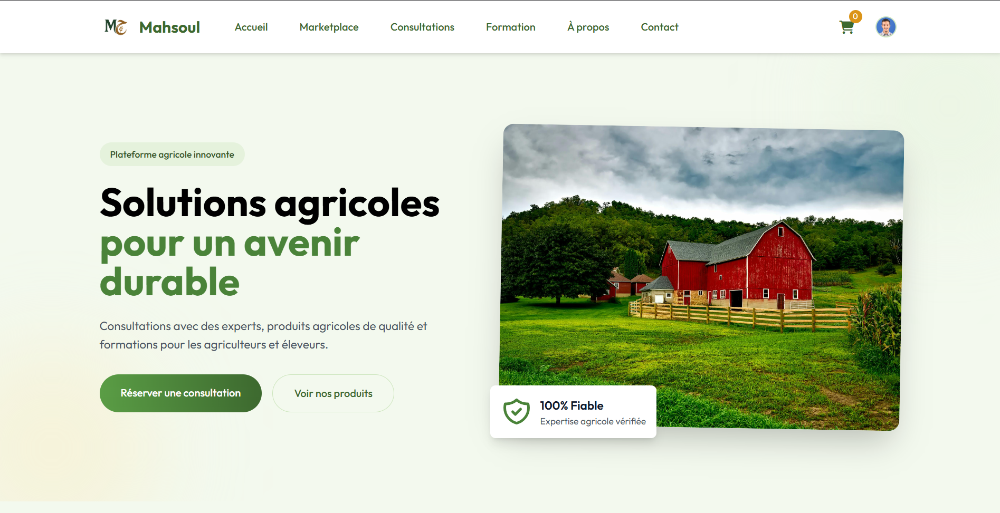
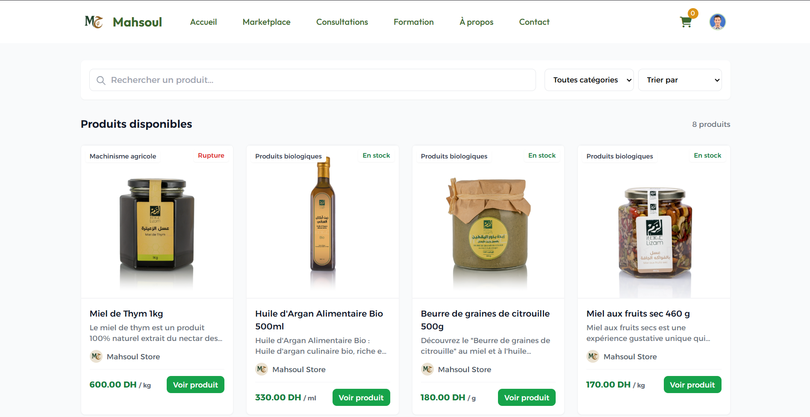
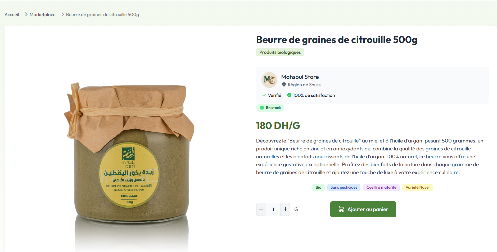
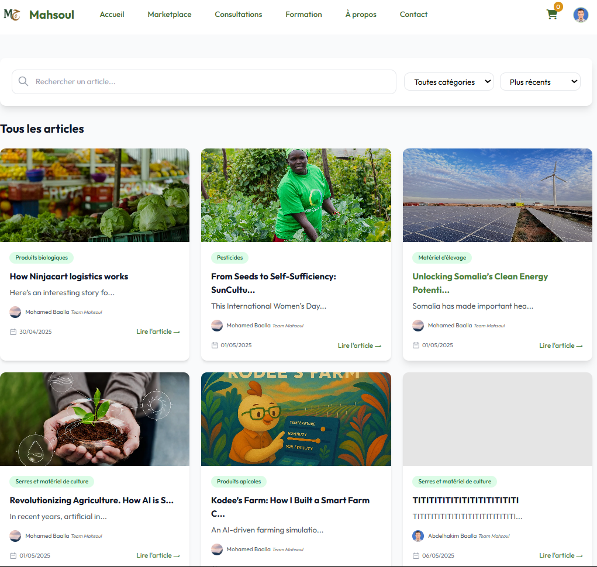
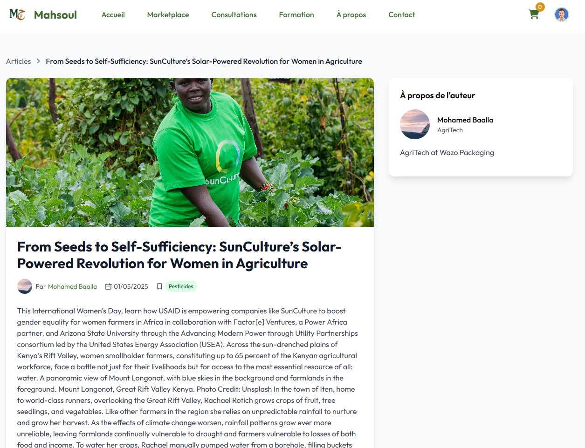
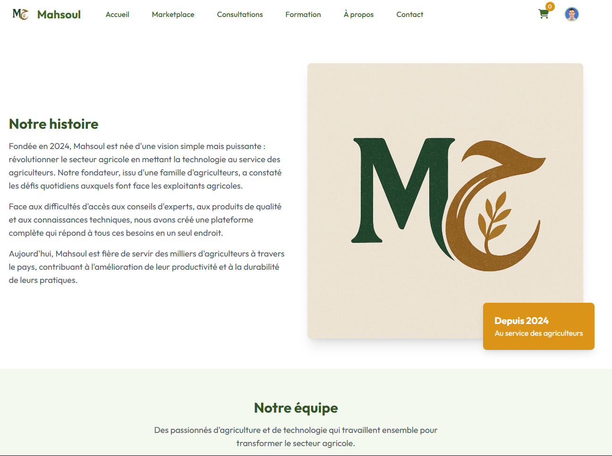
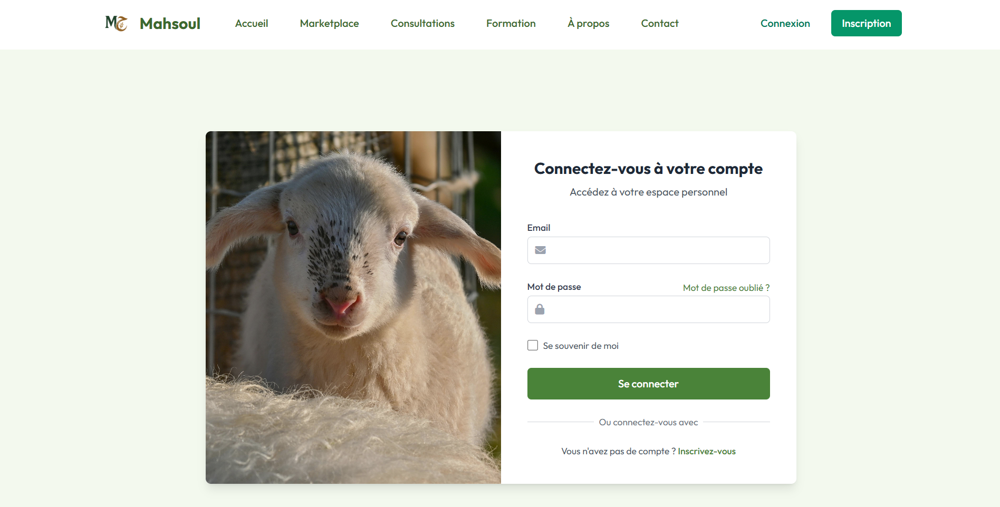
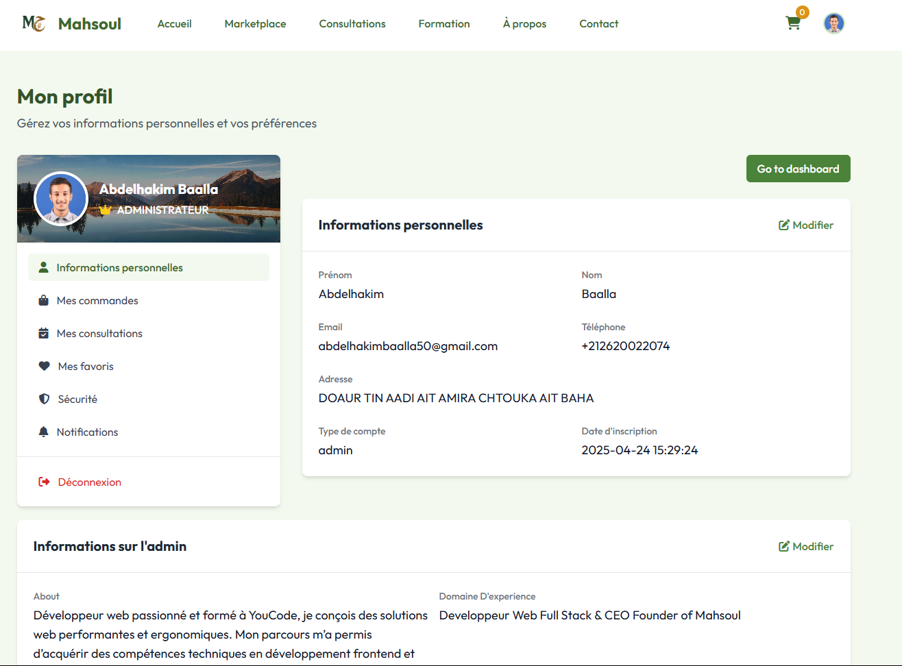

#  Projet Mahsoul - Plateforme Agricole Intelligente

[Visite en lecture seule](https://baalla-mahsoul-demo.abdelhakimbaalla50.workers.dev) · [Parcours des agriculteurs et des experts](https://github.com/Abdelhakim-Baalla/Mahsoul/blob/main/Docs/Diagrames%20PNG/Diagramme-Cas-Utilisation-Mahsoul.jpg)

Pour reconstruire la démo depuis la racine du dépôt avec PHP, Composer, PDO SQLite et les extensions Laravel, exécuter `composer install && php scripts/export-demo.php`. À la racine, `npx wrangler deploy` publie les fichiers générés.

---

## 📌 Avertissement  
*Ce projet est en cours de développement actif - les fonctionnalités peuvent évoluer.*

---

## 🌱 Introduction  

### 🎯 Objectif  
Mahsoul est une plateforme digitale innovante qui connecte les acteurs du secteur agricole (agriculteurs, éleveurs, coopératives) avec des experts et fournisseurs. Notre solution intègre :  
- 🩺 Consultations expertes en ligne  
- 🛒 Marketplace de produits agricoles  
- 📚 Centre de formation digitale  
- ⚙️ Outils de gestion agricole  

### 🌍 Contexte  
Répondre aux défis du secteur agricole marocain par la digitalisation des services clés.

---

## 📸 Captures d'écran

### 🏠 Page d'Accueil


### 🛒 Marketplace
#### Liste des Produits


#### Détails d'un Produit


### 📚 Formation
#### Liste des Articles


#### Détails d'un Article


### 🧾 Autres Pages
#### À Propos


#### Connexion & Inscription



#### Profil Utilisateur


---

## 🛠️ Fonctionnalités Clés  

| Module | Fonctionnalités |
|--------|----------------|
| **👨‍⚕️ Consultations** | Rendez-vous en ligne, Historique, Documents partagés |
| **🛍️ Marketplace** | Catalogue intelligent, Panier, Paiement sécurisé |
| **🎓 Formation** | Articles techniques, Système de commentaires |
| **📊 Dashboard** | Suivi des commandes/consultations |

---

## 💻 Stack Technique  

### 🔧 Backend  
  
  
  

### 🎨 Frontend  
  
  
  
  

### 🛡️ Sécurité  
  

---

## 🚀 Installation et déploiement

```bash
# Cloner le répertoire
git clone https://github.com/Abdelhakim-Baalla/Mahsoul.git
cd Mahsoul

# Installation des dépendances
composer install
npm install

# Configuration
cp .env.example .env
php artisan key:generate

# Base de données
php artisan migrate --seed

# Compilation des assets
npm run dev

# Lancer le serveur de développement
php artisan serve
```

---

## 📚 Ressources  

| Documentation | Lien |
|--------------|------|
| 📊 Jira | [Suivi de projet](https://abdelhakimbaalla50.atlassian.net/jira/software/projects/MA7/boards/7?atlOrigin=eyJpIjoiMjlmZGVmNWY1OWUwNDEyMDhmNzQwMjJjMzE2ZjRjZTMiLCJwIjoiaiJ9) |
| 🎨 Figma | [Maquettes](https://www.figma.com/file/MZ2VPfC0qY0VDvvWyS9343) |
| 📝 Cahier des charges | [Google Docs](https://docs.google.com/document/d/17_ZoQLefHz0ZBXp0kERqQGm4PRlk2iWXElDs6w16hm4) |
| 📊 UML | [Diagrammes](https://mega.nz/folder/1oBQkJJJ#Q7naKqIxvjqoHI--JtQYIg) |

---

---

## 🤝 Contribution  
Les contributions sont les bienvenues ! Veuillez suivre notre [guide de contribution](CONTRIBUTING.md).

---

## 👥 Équipe

- **Abdelhakim Baalla** - Chef de Projet & Développeur Full-Stack

---

## 📄 Licence  
Ce projet est sous licence MIT - voir le fichier [LICENSE](LICENSE).

---

## 📞 Contact

Pour toute question ou suggestion, veuillez nous contacter à [contact@mahsoul.ma](mailto:contact@mahsoul.ma)